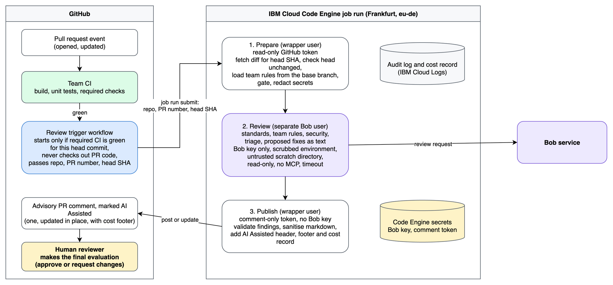

# PR Review Agent with IBM Bob Shell

Reference implementation and write-up for running IBM Bob Shell as an advisory pull request reviewer
in a hardened container on GitHub-hosted runners, triggered from GitHub Actions after the
team's CI has passed. Comments are marked "AI Assisted"; a human makes the final decision.

Status: Phase 5 complete (GitHub trigger and end-to-end matrix complete). See [docs/STATUS.md](docs/STATUS.md).

Run the offline test suite:

```bash
make test    # 263 tests, 0 failures (unit + pipeline, no network)
make lint    # static checks
```



Editable source: [`docs/diagrams/architecture-overview.drawio`](docs/diagrams/architecture-overview.drawio).

## Working on this repository

Start with [AGENTS.md](AGENTS.md), then the current phase brief listed in
[docs/tasks/README.md](docs/tasks/README.md).

## Documentation

- [Documentation index](docs/INDEX.md): complete index of all project documentation
- [Project status](docs/STATUS.md): phase progress, current blockers, and decisions log
- [Project plan](docs/PLAN.md): design, guardrail catalog (G1 to G37), and phased plan
- [System architecture](docs/ARCHITECTURE.md): container isolation, stage split, and data flow
- [Threat model](docs/THREAT_MODEL.md): trust boundaries, abuse cases, and security controls
- [Contracts](docs/CONTRACTS.md): job inputs, secrets, findings schema, comment format, and cost records
- [Testing guide](docs/TESTING.md): running unit, pipeline, mutation, and end-to-end test suites
- [Setup guide](docs/SETUP.md): GitHub repository setup, environment variables, secrets, and first run
- [Operational runbook](docs/RUNBOOK.md): kill switch, secret rotation, triage, and teardown procedures
- [Task briefs per phase](docs/tasks/README.md): self-contained briefs for Phases 0 through 8
- [Architectural Decision Records (ADRs)](docs/adr/0001-execution-environment.md): accepted design decisions (ADR 0001 through ADR 0015)
- [Results and records](docs/results/spikes.md): recorded spike findings, test runs, and evidence
