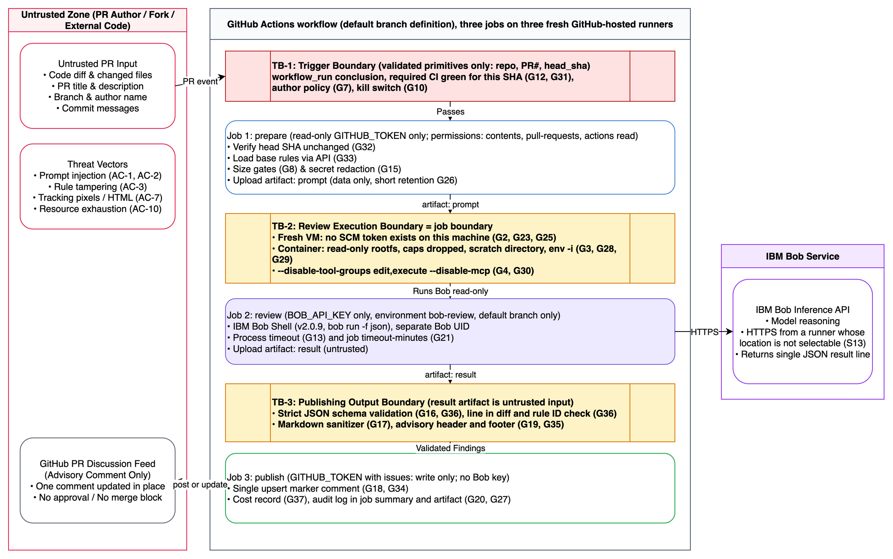

# Architecture

This document describes the system architecture, component breakdown, data flow, isolation model,
failure behaviors, and GitHub trigger analysis for the IBM Bob PR Review Agent. The execution
environment is GitHub-hosted runners ([ADR 0012](adr/0012-github-hosted-runner-execution.md));
credential handling is in [ADR 0013](adr/0013-secrets-and-credentials-on-github.md).

## 1. System Overview

The PR Review Agent is an automated, advisory code review assistant. It operates asynchronously
after continuous integration (CI) tests have passed on a pull request.

Everything runs inside one GitHub Actions workflow that starts from `workflow_run` on the default
branch. It has three jobs, each on its own fresh GitHub-hosted runner (`ubuntu-24.04`) and each
holding a different credential:

1. **`prepare`** holds only a read-only `GITHUB_TOKEN`. It validates the trigger, applies the
   gates, fetches the diff and the base-branch rules through the API, redacts, builds the prompt
   and uploads it as an artifact.
2. **`review`** holds only `BOB_API_KEY` (environment secret). It runs IBM Bob Shell read-only in a
   hardened container on the prompt artifact and uploads the raw result as an artifact.
3. **`publish`** holds only the comment token (`issues: write`). It treats the result artifact as
   untrusted, validates findings, sanitises, and posts or updates a single markdown comment.

The Bob service is the only external dependency besides GitHub.

*(Editable diagram source: [docs/diagrams/trust-boundaries.drawio](diagrams/trust-boundaries.drawio))*

## 2. Components and Responsibilities

### 2.1 Trigger and gates (`prepare` job)
* **Event Listener**: Monitors `workflow_run` events corresponding to required CI workflows, as
  well as manual trigger labels (e.g., `bob-review`).
* **Gate Evaluator**: Evaluates gating rules (G7, G10, G12, G31):
  * Verifies `workflow_run.conclusion == "success"` (the event fires for every conclusion).
  * Verifies `BOB_REVIEW_ENABLED == "true"` (a repository variable, readable in `if:`).
  * Verifies PR author association (`OWNER`, `MEMBER`, `COLLABORATOR`) or presence of maintainer label.
  * Verifies that all required CI workflows concluded with `success` for the exact head commit SHA.
* **Handoff**: validated scalar identifiers (`REVIEW_REPO`, `REVIEW_PR_NUMBER`, `REVIEW_HEAD_SHA`)
  go into the `prompt` artifact. PR code is never checked out on any runner.

### 2.2 The three reviewer stages
The Node.js reviewer core runs the stages as three subcommands, one per job. For local runs and
tests the same stages run in one process.

#### Stage 1: Prepare (job `prepare`)
* Authenticates to GitHub REST API using `SCM_READ_TOKEN` (the job's `GITHUB_TOKEN`).
* Checks head commit SHA pinning: verifies the PR is open and its current head matches `REVIEW_HEAD_SHA` (G32).
* Evaluates size and path gates (G8, G9): drops PRs exceeding file or byte limits, or PRs with only ignored paths (e.g. lockfiles, docs-only diffs).
* Loads team standards (`.bob-review/standards.md`), rules (`.bob-review/project-rules.md`), and optional configuration (`.bob-review/config.json`) strictly from the repository base branch (G33).
* Fetches the unified diff and applies regex secret redaction to mask tokens and private keys before inference (G15).
* Builds the prompt and uploads it with the validated identifiers as artifact `prompt`.

#### Stage 2: Review (job `review`)
* Downloads `prompt`. Starts the pinned container with a read-only root filesystem, tmpfs scratch, dropped capabilities and `no-new-privileges`; `BOB_API_KEY` enters by name only.
* Inside the container, creates the scratch directory (custom mode definition only), hands it to a distinct UID and spawns IBM Bob Shell (`bob run -f json`) in a scrubbed environment (`env -i`) where only `BOB_API_KEY` and necessary runtime variables are present (G2, G3, G23).
* Enforces read-only isolation: passes `--disable-tool-groups edit,execute --disable-mcp` on every run (G4, G30).
* Passes `--workspace <scratch>` pointing to the clean scratch directory, ensuring repository `AGENTS.md` and `.env` files are never loaded (G28, G29).
* Pipes task prompt and code diff directly via standard input (stdin) (S8).
* Enforces process execution timeout (G13) and uploads artifact `result`.

#### Stage 3: Publish (job `publish`)
* Downloads `result` and treats it as untrusted. Captures and parses the single JSON result line from Bob stdout (G16).
* Re-checks the kill switch and head pin, and reads the existing comment marker for the per-PR run cap (G10, G14, G32).
* Validates findings schema: ensures file paths and line numbers exist within the PR diff, rule IDs match supplied base-branch rules, and drops invalid or low-confidence entries (G36).
* Passes finding text through the markdown sanitizer to strip HTML tags, external images, `@mentions`, and bidirectional unicode control characters (G17).
* Attaches immutable AI-Assisted header and footer metadata, including commit SHA, Bob version, run ID, and cost (G19, G35, G37).
* Authenticates to GitHub REST API using `SCM_COMMENT_TOKEN` and idempotently upserts the review comment using a hidden HTML marker (G18).
* Writes the structured audit log to the job summary and artifact `audit` without code or secret content (G20, G27).

## 3. Isolation

The security model prevents untrusted PR contents from compromising secrets or gaining system
access. The main boundary is the job boundary; container controls are defence in depth
([ADR 0006](adr/0006-in-container-isolation.md)).

### 3.1 Credential separation
* `BOB_API_KEY` exists only in the `review` job. The read-only token exists only in `prepare`. The
  comment token exists only in `publish`. Separate fresh VMs share only artifacts (G2, G23, G25).
* Each job sets `permissions:` explicitly; the workflow default is `permissions: {}`.
* When invoking Bob Shell, the wrapper uses `child_process.spawn` with an explicit scrubbed
  environment allowlist (`env -i` semantics). SCM tokens are not in the `review` job at all, so
  even successful environment reflection by the model finds no GitHub credential.
* Forks and Dependabot runs receive no secrets from the platform; the workflow only runs from the
  default branch via `workflow_run`.

### 3.2 Tool and File Isolation
* Bob Shell v2 tools are categorized into groups. Passing `--disable-tool-groups edit,execute`
  removes `write_file`, `insert_content`, `apply_diff`, `execute_command`, and related tools from
  the model context.
* `--disable-mcp` ensures no local or remote MCP servers are started or queried.
* `--workspace` restricts file access tools to the scratch directory; attempts to access parent
  directories are rejected by Bob runtime checks.
## 4. GitHub Trigger and `workflow_run` Paper Analysis (S15)

Unknown S15 analyzes how `workflow_run` interacts with pull requests, fork PRs, and commit updates:

### 4.1 Trigger Mechanics
* `workflow_run` triggers when a target workflow (e.g. `CI`) completes on any branch or pull request.
* Crucially, workflows triggered by `workflow_run` always execute the workflow definition from the
  **default branch** (`main`), with access to repository secrets and read/write tokens.
* The event payload (`github.event.workflow_run`) contains metadata about the triggering workflow:
  * `event`: `"pull_request"`
  * `conclusion`: `"success"`, `"failure"`, or `"cancelled"`
  * `head_sha`: the commit SHA that was tested
  * `pull_requests`: an array of PR summary objects associated with that head SHA

### 4.2 Security and Integrity Properties
1. **Fork PR Safety**: Because the workflow definition is read from `main`, hostile code in a fork
   PR cannot modify the workflow logic or steal GitHub Actions secrets, and the platform does not
   pass secrets to fork-triggered workflows (see [runner facts](results/runner-facts.md)).
2. **Head Commit Verification**: The trigger checks `github.event.workflow_run.conclusion == 'success'`
   and extracts `head_sha`. If multiple PRs match, or if the PR head has already advanced, head
   pinning (G32) in `prepare` and `publish` ensures stale runs exit without action.
3. **Outside Contributor Handling**: The trigger checks PR author association or labels before
   starting the `review` job, preventing denial-of-wallet attacks from unauthorized forks (G7).

### 4.3 Open Points for Phase 5 Testing
* Race conditions when multiple CI workflows finish concurrently for the same PR.
* Behavior when a PR is updated while CI is running (canceling previous workflow runs via concurrency groups).
* Handling of PRs from private forks or internal branches with distinct permission levels.

## 5. Job Outcomes and Failure Behavior

The reviewer handles edge cases and operational failures deterministically. To avoid noisy failed
workflow runs, the wrapper always exits with code 0 on handled outcomes and records the event in
the audit log (CONTRACTS section 8):

| Outcome Code | Condition | Action Taken | Comment Posted |
|---|---|---|---|
| `reviewed` | Review completed successfully with schema-valid output | Comment created or updated with findings | Yes |
| `skipped_disabled` | Kill switch active (`REVIEW_ENABLED != "true"`) | Exits immediately | No |
| `skipped_stale` | PR closed or head SHA moved since trigger | Exits immediately | No |
| `skipped_gate` | PR is draft, bot, docs-only, or exceeds size limits | Logs skip reason; posts note only if size gate hit | Note on size gate |
| `rejected_input` | Malformed parameters (regex failure on repo/PR/SHA) | Exits immediately, logs error | No |
| `bob_unavailable` | Bob API auth failure, quota exhaustion, or timeout | Logs error, posts short "Review unavailable" note | Short note |
| `bad_model_output`| Bob output fails JSON extraction or schema validation | Logs error, posts short "Review unavailable" note | Short note |
| `publish_failed` | GitHub API error when posting PR comment | Logs failure to the audit log | No |

## 6. Cost and Usage Tracking

Every execution generates a machine-readable cost record (G37) containing:
* Repository name, PR number, commit SHA, and workflow run id and attempt.
* Input metrics: changed file count, diff bytes, prompt bytes.
* Output metrics: findings kept, findings dropped.
* Bob usage: reported usage in Bobcoins (`stats.session_costs` from Bob JSON output).
* Execution timing: total duration and Bob inference duration in seconds; runner label and runner minutes.

The cumulative cost and run count across all reviews of a given PR are preserved in a hidden HTML
comment marker (`<!-- bob-pr-review:v1 {...} -->`) and updated in place.
