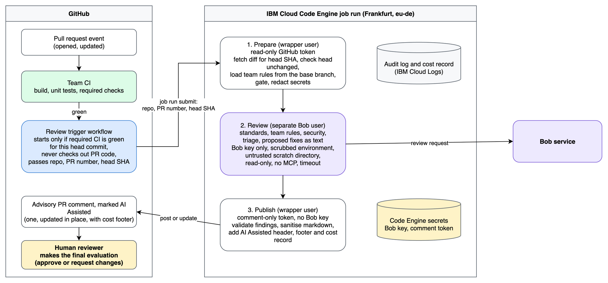

# Project Plan: Bob as a Pull Request Review Agent

Status: working draft, for owner review. Nothing in this plan has been implemented yet.

## Table of contents

1. [Goal and deliverables](#1-goal-and-deliverables)
2. [Design review: pros, cons, implications](#2-design-review-pros-cons-implications)
3. [Architecture](#3-architecture)
4. [Guardrail and harness catalogue](#4-guardrail-and-harness-catalogue)
5. [Known unknowns to verify first](#5-known-unknowns-to-verify-first)
6. [IBM Cloud target](#6-ibm-cloud-target)
7. [Target repository layout](#7-target-repository-layout)
8. [Phased work plan](#8-phased-work-plan)
9. [Test strategy](#9-test-strategy)
10. [Decisions](#10-decisions)
11. [Risks to the project itself](#11-risks-to-the-project-itself)
12. [Possible change cases for future developments](#12-possible-change-cases-for-future-developments)

## 1. Goal and deliverables

Produce a reference implementation and a written account of running IBM Bob Shell as an
advisory pull request reviewer on IBM Cloud Code Engine. The review starts from GitHub Actions
only after the team's own CI (build, unit tests, other required checks) has passed. Bob checks
coding standards, team-specific rules and security, triages what it finds, proposes remediations,
and adds comments clearly marked as AI assisted. It never approves or blocks; a human makes the
final evaluation. The cost of each review is recorded per PR.

| Deliverable | Description | Done when |
|---|---|---|
| D1. Working repository | Reviewer core, container image, Code Engine deployment scripts, GitHub Actions trigger, sample target repo with CI and team rules | CI is green and the end-to-end test passes in a sandbox repo through Code Engine |
| D2. Test and red-team harness | Unit tests, fake-Bob pipeline tests, prompt-injection corpus, review-quality eval set | `make test` passes offline; live suites documented and run at least once with results recorded |
| D3. Article | Short LinkedIn article for the owner's network and clients: technical problems, security implications, benefits, honest limitations | Every claim is traceable to a doc source or a recorded test result |

Out of scope: applying fixes to code, approving or blocking merges, CI systems other than GitHub
Actions, SCMs other than GitHub, a hosted multi-tenant service. Possible extensions are listed in
[section 12](#12-possible-change-cases-for-future-developments).

## 2. Design review: pros, cons, implications

### Pros

- Consistent first-pass review on every PR, applying the team's standards and rules.
- Agentic: can read surrounding files, not only the diff (the main gain over a diff-to-LLM script).
- Runs only on PRs that already build and pass tests, so spend and reviewer attention go to code
  that is worth reviewing.
- Bob Shell has a documented non-interactive mode, API-key auth for CI, and read-only tool defaults.
- The Bob API key lives in Code Engine, not in the CI system.
- Prebuilt, pinned image: no per-run install.
- Resources are chosen per job (documented job maximums: 12 vCPU, 48 GB memory, 24 h timeout).

### Cons

- Non-deterministic output: cannot be a hard merge gate.
- Cost scales with PR size and push frequency (Bobcoins plus Code Engine vCPU and memory seconds;
  image pull time is billable).
- Per-PR spend is not available from a documented source: Bobalytics reports team-level Bobcoin
  spend (section 3, cost visibility), so the job has to produce its own per-PR record.
- Adds an attack surface: the model reads attacker-controlled text.
- More moving parts: IBM Cloud project, container registry, IAM.
- Debugging is harder: `jobrun logs` returns no data once the instance has completed, so run logs
  must be shipped elsewhere (IBM Cloud Logs) or recorded by the job itself.
- Review quality is unproven until measured on our own data.

### Implications to confront

1. **The model is not the trust boundary; the wrapper is.** Any control that relies on the model
   behaving is a mitigation, not a guardrail.
2. **Output cannot be read from outside after the job ends**, so the job must publish the comment
   itself. That puts an SCM comment credential inside the container next to the model process.
   Mitigated by process isolation inside the container (section 3) and a minimal-scope token.
3. **The CI credential is more powerful than "submit a review".** A service ID that can submit job
   runs can, per the documented `jobrun submit` options, also override the command, arguments, and
   secret references of a run. A leaked CI key may therefore expose the Bob key and the comment
   token, not just burn compute. Mitigated by scoping the service ID to one project, by rotation,
   and by verifying the real permission model (S12).
4. **Output is untrusted too.** Rendered markdown (image URLs, links, @mentions, HTML) is an
   exfiltration and abuse channel. Validate and sanitise before posting.
5. **Fork PRs.** The trigger workflows never check out PR code and carry no model-readable
   secrets, which makes them manageable. Policy is still explicit (G7).
6. **Data egress and residency.** Source and diffs go from Code Engine (eu-de) to the Bob service.
   Bob documents eu-de, us-east and jp-tok endpoints; which one applies to our Bob instance and
   what residency it guarantees must be confirmed (S13), then stated in the article.
7. **Key ownership.** Bob API keys are scoped to a user and a subscription instance; revocation
   breaks the pipeline. Needs an operational owner and a rotation procedure.
8. **Duplicate and runaway runs.** Retries, re-pushes, re-runs, and several CI workflows finishing
   for the same commit must not post duplicate comments or burn budget. Code Engine's default of
   3 retries must be disabled.
9. **Egress control is coarse.** Code Engine outbound restrictions are IP ranges, not domains, and
   context-based restrictions are not supported for jobs. Egress stays open and other controls
   carry the load; this is recorded as an accepted residual risk.
10. **Bob loads configuration from its working directory.** Bob Shell reads project settings
    (`.bob/settings.json`), rules, custom commands and `AGENTS.md` from the project directory, and
    a folder with no recorded trust decision is treated as trusted in non-interactive mode. A PR
    could ship a settings file that defines an MCP server, or an `AGENTS.md` that competes with
    our prompt. Bob must never run in a directory that contains PR-controlled files. Per the Bob
    docs, an untrusted folder ignores project settings, does not connect MCP servers, does not load
    custom commands, and overrides `--yolo`. The design runs Bob in a scratch directory that is
    explicitly marked untrusted and holds only data prepared by trusted code (G28 to G30).
11. **Reviewer fatigue.** A noisy bot gets ignored. Triage, caps on findings, and a confidence
    threshold matter as much as security.
12. **Team rules are an input the PR author must not control.** If the rules are read from the PR
    branch, a PR can rewrite the rules it is judged by. Rules are read from the base branch only
    (G33), so changing them is itself a reviewed and merged change.
13. **The CI result must refer to the same commit that gets reviewed.** A push after CI started
    changes the head; the review must be pinned to the commit CI validated, and skipped if the PR
    has moved on (G31, G32).
14. **The bot must be unable to approve, even by mistake.** A token that can post comments may also
    be able to submit approving reviews through another endpoint. The publisher is restricted to
    one endpoint and the bot is a dedicated account that is not a code owner (G34).

## 3. Architecture



Editable source: [`diagrams/architecture-overview.drawio`](diagrams/architecture-overview.drawio).

### Trigger path: review only after CI has passed

```
Team CI on the pull request (build, unit tests, other required checks; defined by the team)
  -> every required CI workflow concludes success for the PR head commit
Review trigger workflow (workflow_run, default-branch definition, NO checkout of PR code)
  resolves the PR for the head SHA through the API and validates: required CI green for this
  SHA, PR open and head unchanged, not draft, repo name, PR number (integer),
  author_association, labels, kill switch
  -> ibmcloud ce jobrun submit with only REPO, PR_NUMBER, HEAD_SHA
     (authenticates with an IBM Cloud service ID API key stored as a GitHub secret)
  -> Code Engine job run (eu-de)
```

- If CI fails or is cancelled, no review is started and nothing is posted; the author already has
  the CI failure.
- Why `workflow_run`: the team's CI keeps running on `pull_request` without any secret. GitHub
  documents that a `workflow_run` workflow can access secrets and write tokens even when the
  triggering workflow could not, which suits a privileged follow-up step. It only runs if its
  workflow file is on the default branch, and the documentation warns against running untrusted
  code in it. The trigger therefore never checks out PR code and takes nothing from the
  triggering run except the head SHA (G6, G24).
- The event fires once per completed workflow. When several workflows are required, each
  completion re-evaluates the same check ("all required CI green for this SHA"), and the
  concurrency group plus idempotent job (G11, G18, G31) make the repeats harmless.
- Explicit re-request: a second small trigger on `pull_request_target` (`labeled`, label
  `ai-review`, no checkout) runs the same validation script, including the CI-green check.
- How `workflow_run` behaves for fork PRs (PR lookup from the head SHA, payload contents) is not
  confirmed; spike S15.
- Dependabot PRs are treated like fork PRs by GitHub.

### What the review does

| Task | Trusted input | Output |
|---|---|---|
| Coding standards | `.bob-review/standards.md`: numbered rules, read from the base branch | Findings that cite the rule ID |
| Team-specific rules | `.bob-review/project-rules.md`: architecture, naming, forbidden APIs, test expectations, read from the base branch | Findings that cite the rule ID |
| Security review | Built-in checklist in the reviewer mode, plus optional `.bob-review/security.md` focus list | Findings with severity, confidence, evidence (file and line) |
| Signal triage | Confidence threshold, per-category caps, de-duplication, severity ranking | Low-confidence items dropped or moved to "needs human attention" |
| Remediation | The finding and the surrounding code | A proposed fix as text or a diff in a code block; never applied |

Rules and standards are passed to Bob as data inside the prepared prompt, not as Bob rule files
or `AGENTS.md`, so they cannot be confused with configuration and are always the base-branch
version. Missing rule files mean the review runs with the built-in checklist only and says so.

### Human decision

- The comment states that it is AI assisted, advisory, and that the final evaluation belongs to a
  human reviewer. The header and footer are produced by the wrapper, not by the model (G35).
- The bot posts a plain PR comment only. It does not submit approving or change-requesting
  reviews, does not write check runs or commit statuses, and is never a required check (G34).
- Merge rules stay with the team: branch protection with required human approval is recommended
  and documented in the setup guide, not enforced by this project.
- The comment ends with a "needs human attention" section for items the model was unsure about.

### Inside the job (three stages, different privileges)

```
Stage 1 PREPARE   (wrapper, UID "wrapper"; holds read-only SCM token)
  fetch PR metadata + diff for HEAD_SHA through the API, never execute PR code
  verify HEAD_SHA is still the PR head (else exit quietly)
  fetch .bob-review/ rules from the base branch
  gate: draft/bot/size/path/budget/kill-switch
  redact obvious secrets, build prompt with explicit untrusted-data delimiters
        |
Stage 2 REVIEW    (bob process, UID "bobrun"; holds ONLY the Bob key)
  scrubbed environment, read-only tools, no MCP, timeout, bounded input,
  working directory contains only the prepared prompt, rules and diff
        |
Stage 3 PUBLISH   (wrapper again; holds comment-only SCM token)
  validate output schema and finding locations, apply triage rules, sanitise markdown,
  add AI assisted header and footer (with cost record), upsert a single marker comment
  (idempotent), write run record
```

Isolation requirement: the comment token must not be readable by the Bob process or anything the
model can make it run. Candidate mechanisms, in order of preference (feasibility decided by spike
S11):

1. Two Linux users in one container: the wrapper holds SCM tokens in its environment; Bob is
   started as a different unprivileged user so it cannot read the wrapper's `/proc/<pid>/environ`.
2. Two job runs: a review job (no SCM write token) writes the result to a mounted data store;
   a publish job reads it. Heavier, cleaner boundary.
3. Fallback if neither is workable: single process with a minimal-scope token (comment on this one
   repository only), with the residual risk documented in the article.

### Cost visibility per PR

What the documentation says: Bobalytics shows Bobcoin spend as a team-level KPI (total over a
period, daily spend, team trends), and team-level views anonymise user identities. The documented
Bobalytics material does not describe per-PR or per-run spend, and the IDE page notes that
enterprise users must keep telemetry enabled to appear in it. Whether Bob Shell runs show up in
Bobalytics, and whether a dedicated API key or user can be filtered, is unverified (S16).

The job therefore produces its own record for every run:

| Field | Source |
|---|---|
| Repo, PR number, head SHA, run id, Bob Shell version | Job inputs and the image |
| Input size (files, diff bytes, prompt bytes) and output size | Wrapper |
| Bob usage (tokens or Bobcoins) | First choice: figures reported by Bob Shell if any (S7). Fallback: estimate from prompt and output size, labelled as an estimate |
| Wall-clock seconds, vCPU and memory of the job | Wrapper and job definition |
| Estimated Code Engine compute cost | Seconds x configured vCPU and GB rates; rates live in a config file, not retrieved yet |
| Cumulative per-PR totals | Counter in the hidden metadata of the marker comment |

The record goes to three places: a one-line cost footer in the PR comment (visible to the team and
auditable in the PR history), a hidden machine-readable block in the same comment (feeds the
per-PR cap in G14), and the structured audit log shipped to IBM Cloud Logs (G20).
Reconciliation: daily sums of the records are compared with Bobalytics daily spend when it is
available, and the article states how close the estimates are.

### Principles

- Advisory only. Never a required check; failure to review must never block a merge.
- Fail closed on the review, fail open on the pipeline: any error produces at most a short
  "review unavailable" note, never a red build on someone else's PR.
- The reviewer core takes a repository, a PR number and a head SHA and produces one comment. The
  GitHub Actions workflows are thin launchers around it.
- Everything pinned: action SHAs, Bob Shell version, Node version, container base image.

## 4. Guardrail and harness catalogue

Each item names the control, its type, and the test that proves it.

| ID | Control | Type | Proven by |
|---|---|---|---|
| G1 | Workflow `permissions:` least privilege (`contents: read` at most; no write scopes on the triggers) | Preventive | actionlint, zizmor |
| G2 | Separate credentials per stage: read-only SCM token (prepare), comment-only (publish), Bob key only (review) | Preventive | Unit test on env construction |
| G3 | Scrubbed environment for the Bob process (`env -i` plus allowlist) | Preventive | Canary env var test |
| G4 | Bob read-only: `--disable-tool-groups edit,execute --disable-mcp` on every `bob run` invocation; no overridable flags | Preventive | Live test: injected "write file" attempt leaves tree unchanged; assert stats.tool_calls==0 |
| G5 | Trusted-folders pre-seeding for the working directory | Preventive | Spike S4 and live test |
| G6 | PR code is never checked out or executed; trigger workflows use default-branch definitions only and take nothing from the triggering run except the head SHA | Preventive | Workflow lint, job graph review, hostile-artifact test in the sandbox |
| G7 | Author policy: auto-review only for OWNER, MEMBER, COLLABORATOR; others need a maintainer-applied label | Preventive | Sandbox e2e with a fork and an outside account |
| G8 | Size gates: max files, max diff bytes, max prompt size estimate | Preventive | Unit tests with boundary fixtures |
| G9 | Skip rules: drafts, bots, docs-only, generated and lock files, `skip-bob-review` label | Preventive | Unit tests |
| G10 | Kill switch: repo variable `BOB_REVIEW_ENABLED` checked in the triggers, and a Code Engine env flag checked in the job | Preventive | Workflow e2e |
| G11 | Concurrency group per PR, cancel superseded runs | Preventive | Sandbox e2e with two quick pushes |
| G12 | Triggers limited to completion of the required CI workflows, plus explicit re-request by label | Preventive | Sandbox e2e |
| G13 | Hard timeout on the Bob process (in wrapper) and on the job (`--maxexecutiontime`) | Preventive | Fake-Bob "hangs" test and deploy test |
| G14 | Budget: per-PR run cap, enforced from the marker (no daily caps, ADR 0009) | Detective + preventive | Unit tests |
| G15 | Secret redaction on the diff before it is sent | Preventive | Unit tests with seeded fake secrets |
| G16 | Output schema validation with a strict, versioned format | Preventive | Fake-Bob malformed output tests |
| G17 | Markdown sanitiser: strip images, raw HTML, @mentions, non-allowlisted links, control and bidi characters; cap length; code fences allowed for proposed fixes | Preventive | Unit tests and injection corpus |
| G18 | Idempotent upsert of one marker comment (never spam) | Preventive | Unit test and sandbox e2e |
| G19 | Footer stating AI assisted, advisory, with Bob version, head SHA and run id (see also G35) | Transparency | Snapshot test |
| G20 | Structured audit log per run to stdout and IBM Cloud Logs (PR, sizes, duration, decision, cost record, no content) | Detective | Unit test on log schema; live check that logs arrive |
| G21 | Job config: `--retrylimit 0`, short `--maxexecutiontime`, secrets via `--env-from-secret`, non-root user | Preventive | Deploy script test and live e2e |
| G22 | Supply chain: pin Bob Shell version (checksum if published), pin base image by digest, pin actions by SHA | Preventive | zizmor, CI check |
| G23 | In-container privilege separation: Bob process cannot read the wrapper's credentials (S11) | Preventive | Canary test: model-influenced command tries to read parent environ and credential files |
| G24 | Triggers pass only validated identifiers (repo `owner/name` pattern, integer PR number, 40-hex head SHA); the PR is resolved through the API; titles, bodies, branch names are never put in env, args, or shell strings | Preventive | Unit tests with hostile values; workflow lint |
| G25 | Least-privilege IBM Cloud identity for the trigger: service ID scoped to this one project with the smallest role that can submit job runs; rotation procedure (S12) | Preventive | IAM policy review and negative test (key cannot touch other projects) |
| G26 | Job-run hygiene: delete job runs older than N days (100-run project limit) | Operational | Scheduled cleanup test |
| G27 | Secrets never printed: log scrubber plus a test that greps captured logs for canary secrets | Detective | Unit test and live log check |
| G28 | Bob runs in a scratch directory that contains only prepared data (diff, changed files, rules, prompt); no PR-controlled `.bob/`, `AGENTS.md`, rules, commands or `.env` can be present | Preventive | Fixture PR that ships hostile `.bob/settings.json`, `AGENTS.md` and `.env`; assert none take effect |
| G29 | `--workspace <scratch>` on every `bob run` points to a clean directory containing no `AGENTS.md`; trusted-folders mechanism does not control tool availability in v2 (S4) | Preventive | Spike S4/S14 and live test that AGENTS.md in cwd is ignored when --workspace is clean dir |
| G30 | MCP disabled via `--disable-mcp`; write/execute tools disabled via `--disable-tool-groups edit,execute`; no image settings manipulation needed in v2 (S14) | Preventive | Spike S14 and live test |
| G31 | Review starts only when every required CI workflow has concluded success for the exact head SHA; failed, cancelled or missing CI means no review and no comment | Preventive | Sandbox e2e (red CI, green CI, one of two workflows green); unit tests on the gate |
| G32 | Head pinning: the job reviews the SHA it was given and exits quietly if the PR head has moved or the PR is closed | Preventive | Sandbox e2e with a push between CI and review; unit test |
| G33 | Team rules and standards are read from the base branch through the API, never from the PR head; size cap; changes to `.bob-review/` take effect only after merge | Preventive | Fixture PR that edits its own rules; assert the old rules are used |
| G34 | Never approves or blocks: publisher calls only the PR comment create and update endpoints; no reviews, check runs or commit statuses; dedicated bot account that is not a code owner; never a required check | Preventive | Unit test with a mocked API that fails on any other endpoint; token scope review; sandbox check that the bot cannot satisfy a required-approval rule |
| G35 | Wrapper-generated "AI Assisted" header and footer stating advisory status and that a human makes the final decision; model text cannot alter or imitate them (imitations are stripped) | Transparency | Snapshot test; injection test where the model emits a fake approval or fake header |
| G36 | Findings contract: category (standards, team rule, security, other), severity, confidence, rule ID for standards findings, file and line that exist in the diff, evidence, proposed fix text; low-confidence items dropped or moved to "needs human attention"; per-category cap; de-duplication | Preventive | Fake-Bob outputs with hallucinated locations, duplicates and floods; eval set for precision |
| G37 | Per-PR cost record produced for every run (fields in section 3), shown in the comment footer, stored in hidden metadata and the audit log | Detective | Unit tests on the record schema and cumulative counter; live reconciliation against Bobalytics daily spend where available |

Prompt-injection stance: assume it will sometimes work on the model. Controls G2, G3, G4, G16,
G17, G23, G34, G35 make a successful injection low impact (no secrets reachable, no write path, no
approval path, output constrained and visibly labelled).

## 5. Known unknowns to verify first

Phase 0 resolved S1 to S10, S13, and S14 on 2026-10-30.
Answers are in [docs/results/spikes.md](results/spikes.md).
S11 and S12 need the IBM Cloud project (Phase 4). S15 needs a sandbox GitHub repo (Phase 5); it
is analysed on paper in Phase 1. S16 is answered in Phase 7 by someone with Bobalytics access
looking at the dashboard after the first live runs; it is optional and blocks nothing, because the
job writes its own cost record regardless.

| ID | Question | Why it matters | Status |
|---|---|---|---|
| S1 | Does `curl bob.ibm.com/download/bobshell.sh \| bash` work non-interactively in a Linux container, where does it install, how is it pinned to a version, is a checksum published? | Dockerfile and G22 | Answered: installer supports `--version X.Y.Z --pm npm`; no checksum file; npm registry integrity is the safeguard. Container install tested in Phase 4. |
| S2 | Exact flags for read-only operation, tool allow/deny, and is there a machine-readable output option? | Output contract (G16) | Answered (v2): `bob run -f json`; `--disable-tool-groups edit,execute --disable-mcp`; stats.session_costs per run. |
| S3 | Can a custom mode be selected non-interactively, and from a repo-local or image-baked file? | Reviewer prompt packaging | Answered (v2): `--mode <slug>`; project `.bob/custom_modes.yaml` in `--workspace` dir loaded; no image-baking needed. |
| S4 | How do trusted folders behave non-interactively? | G29 | Answered (v2): trusted folders do NOT control tool availability in v2; `--disable-tool-groups` is the mechanism; `--workspace` controls project config scope. |
| S5 | What happens when the model tries a disallowed tool? | G4 test oracle | Answered (v2): with `--disable-tool-groups edit,execute`, write tools absent; stats.tool_calls=0; exit code 0. |
| S6 | Exit codes and error output for auth failure, quota exhaustion, timeout | Failure handling | Answered (v2): auth failure exit 1 + plain text to stderr; empty prompt exit 1; budget overrun exit 0; API key env var is BOB_API_KEY. |
| S7 | Does a non-interactive run report token or Bobcoin usage anywhere? | G14, G37, cost section of the article | Answered (v2): stats.session_costs (USD) in `-f json` result. No token breakdown. No Bobcoin counter. |
| S8 | Can Bob read files outside the workspace, and can stdin carry a large prompt? | Prompt delivery design | Answered (v2): outside-workspace file access denied; stdin works for large prompts (200KB tested); deliver diff via stdin. |
| S9 | Which system packages does Bob need beyond Node? | Dockerfile | Answered (v2): Node 22+ (24+ preferred); npm; package is @ibm/bob. Verify in Phase 4. |
| S10 | Rate and concurrency limits on one API key | Parallel PR handling | Unresolved: no documentation found. Assume one-at-a-time; verify empirically in Phase 3. |
| S11 | Can the Code Engine container run an entrypoint that starts Bob as a different unprivileged UID? | G23 | Open: Phase 4. |
| S12 | Smallest Code Engine IAM role that can submit job runs; can it be limited to one project? | G25, implication 3 | Open: Phase 4. |
| S13 | Which Bob service region applies to our instance, does a Code Engine job in eu-de reach it, and what data-residency statement can we make? | Implication 6, article | Unresolved: no region documentation found. Owner should check the Bob portal. Article states "unverified". |
| S14 | Format of trustedFolders.json; which settings keys pin approval mode and disable MCP and AGENTS.md loading? | G28 to G30, egress risk | Answered: trustedFolders.json format confirmed; project settings ignored when untrusted; AGENTS.md loads regardless of trust (disable via `"bob-cline.useAgentRules": false` in user-level settings.json); .env not loaded; MCP blocked per docs. |
| S15 | `workflow_run` behaviour in practice for fork PRs | G6, G24, G31, G32 | Open: Phase 5 (live), analysed on paper in Phase 1. |
| S16 | Does Bobalytics show Bob Shell API-key usage? | G37, reconciliation | Open: Phase 7, optional. |

Decision gate after Phase 0 (recorded 2026-10-30):

- **Read-only enforcement** (S2, S5): Reliable for file writes and shell execution when running
  from an untrusted directory. Write tools are absent from the tool set; files.totalLinesAdded=0
  is the test oracle. The Dockerfile must not pre-trust the scratch directory. No additional OS
  sandbox is strictly required to prevent file writes, but the planned read-only rootfs mount is
  kept for defense-in-depth.
- **AGENTS.md gap**: AGENTS.md is loaded even from untrusted folders. Mitigation: bake
  `"bob-cline.useAgentRules": false` into the image's user-level settings.json, and assert the
  scratch directory contains no AGENTS.md before each run. This replaces the G30 assumption that
  `/etc/bobshell/settings.json` is the control (that path was not confirmed to exist; user-level
  `~/.bob/settings.json` is the verified key location).
- **Usage reporting** (S7): stats.sessionCost is available in -o json output on every successful
  run. Per-PR cost is a labelled estimate; the article says so.
- **Reviewer mode delivery** (S3, S14): mode YAML baked at `~/.bob/settings/custom_modes.yaml`;
  selected via `--chat-mode`; project-level file not used.
- **Scratch directory trust** (S4): Leave trustedFolders.json absent or with no entry for the
  scratch path; this is sufficient for tool restriction. Add an explicit untrust entry for defense-
  in-depth if the trustedFolders.json ownership allows it.

## 6. IBM Cloud target

IBM Cloud is not provisioned yet and is needed only from Phase 4. Code Engine requires a
Pay-as-you-Go account. The names below are placeholders; change freely before Phase 4.

| Item | Value |
|---|---|
| Region | Frankfurt, `eu-de` (Code Engine is available there, multizone region) |
| Resource group | `bob-pr-reviewer-rg` (created ad hoc) |
| Code Engine project | `bob-pr-reviewer` |
| Container Registry namespace | `bob-pr-reviewer` (regional registry for `eu-de`; confirm domain in Phase 4) |
| Image | `pr-reviewer` |
| Job | `pr-reviewer` |
| Secrets | `bob-creds` (Bob key), `scm-creds` (read-only token and comment token, two keys; see [CONTRACTS.md](CONTRACTS.md)) |
| Service ID | `bob-pr-reviewer-ci` |

Secrets are held only as Code Engine secrets, referenced by the job through `--env-from-secret`.
The CI service ID API key is the one IBM credential stored in GitHub (as an Actions secret).

Local tooling already present on this machine: `ibmcloud` CLI, `gh`, `node` (v26.3.1) and `bob`.
`docker` is absent, so images are built remotely with `ibmcloud ce buildrun submit --source .`.
Login state of the IBM Cloud CLI has not been checked yet.

Resources are created in Phase 4 by scripts under `integrations/code-engine/`, so the setup is
reproducible and can be torn down in one command.

## 7. Target repository layout

```
.
├── README.md
├── AGENTS.md                     # instructions for any Bob/agent session working on this repo
├── Makefile                      # test, lint, build targets
├── docs/
│   ├── INDEX.md
│   ├── PLAN.md                   # this file
│   ├── STATUS.md                 # phase tracker, updated by every task
│   ├── CONTRACTS.md              # shared interfaces: job inputs, findings schema, comment format, cost record
│   ├── tasks/                    # one self-contained brief per phase
│   ├── ARCHITECTURE.md
│   ├── THREAT_MODEL.md
│   ├── SETUP.md                  # IBM Cloud, GitHub, secrets, first run
│   ├── TESTING.md                # how to run every suite and read results
│   ├── RUNBOOK.md                # key rotation, kill switch, incident steps, teardown
│   ├── ARTICLE.md                # the narrative deliverable
│   ├── adr/                      # architecture decision records
│   ├── results/                  # recorded spike, red-team, eval, cost outputs
│   └── diagrams/                 # .drawio sources and exported .png
├── reviewer/                     # core that runs inside the job
│   ├── src/                      # prepare, gate, rules, redact, prompt, run-bob, validate, triage, sanitise, cost, publish
│   ├── prompts/                  # reviewer prompt templates and output schema
│   ├── modes/                    # Bob custom mode definition for the reviewer
│   ├── config/                   # cost rates, caps, thresholds
│   └── package.json
├── integrations/
│   ├── code-engine/              # Dockerfile, entrypoint, setup/teardown scripts, job definition, cleanup
│   └── github-actions/           # review trigger workflows (workflow_run, label re-request), no checkout
├── examples/
│   └── sandbox-repo/             # small app, its CI workflow (build + tests), .bob-review/ sample rules, seeded-flaw branches
├── tests/
│   ├── unit/
│   ├── pipeline/                 # fake-bob shim driven tests
│   ├── fixtures/                 # sample diffs, malicious outputs, secrets
│   ├── redteam/                  # injection corpus and canary harness (live)
│   └── evals/                    # seeded-bug PRs and scoring script (live)
├── scripts/
│   ├── spikes/                   # Phase 0 probes
│   └── validation/               # lint and policy checks
└── .github/workflows/            # this repo's own CI (lint, unit, pipeline tests)
```

Language choice for `reviewer/`: Node.js (Bob Shell already requires Node 22.15 or later, so no
extra runtime), plain ESM with `node:test`, minimal or zero dependencies to keep the supply chain
small.

## 8. Phased work plan

Each phase ends with a gate. Do not start the next phase until the gate passes. Each phase has a
self-contained brief in [docs/tasks/](tasks/README.md); progress is tracked in
[STATUS.md](STATUS.md).

### Phase 0: Spikes against the real Bob CLI (local, cheap)

Work: scripts under `scripts/spikes/` answering S1 to S10, S13 and S14 (S7 covers what usage
information a run exposes); capture outputs in `docs/results/spikes.md`. Needs no cloud or GitHub
resources.
Gate: every unknown has a recorded answer or an explicit "unresolved, assume worst case" note;
read-only enforcement decision made (see decision gate in section 5); cost reporting approach
chosen (reported, or estimated).

### Phase 1: Threat model, ADRs, architecture freeze

Work: `THREAT_MODEL.md` (assets, actors, trust boundaries, abuse cases, per-control mapping to
G-IDs), `ARCHITECTURE.md` with draw.io diagrams, ADRs for execution environment (written),
author and fork policy, trigger after CI, output format and findings contract, rules location,
in-container isolation mechanism, cost record format. Paper analysis of S15.
Gate: owner sign-off on author policy, data-egress stance, the review scope table and the
findings contract.

### Phase 2: Reviewer core with offline tests

Work: implement stages 1 to 3 as modules, including head pinning, base-branch rules loading,
findings validation and triage, the AI Assisted header and footer, and the cost record; a
`fake-bob` shim for deterministic runs; unit and pipeline tests covering G2, G3, G8, G9, G13 to
G20, G24, G27, G32 to G37.
Gate: `make test` green offline; mutation check done for each covered guardrail.

### Phase 3: Real Bob integration (local)

Work: swap the shim for real `bob`; reviewer mode file; sample rules in
`examples/sandbox-repo/.bob-review/`; prompt and schema iteration against hand-picked diffs;
record cost and latency per run.
Gate: ten varied diffs reviewed with schema-valid output, rule IDs cited correctly, and a recorded
cost record per run.

### Phase 4: Code Engine foundation (eu-de)

Work: create resource group, project, registry namespace, service ID with scoped policy; Dockerfile
(pinned base image digest, pinned Node and Bob, git, non-root, two users if S11 allows); remote
build; secrets; job with retry 0 and short timeout; manual job run against a real sandbox PR; log
shipping to IBM Cloud Logs; cleanup job; setup and teardown scripts; resolve S11 and S12.
Gate: a manually submitted job run reviews a sandbox PR and posts one comment; logs are retrievable
after completion; teardown script leaves nothing behind.

### Phase 5: GitHub trigger and end-to-end matrix

Work: sandbox repo with a real CI workflow (build and tests); review trigger workflow on
`workflow_run`, label re-request trigger, concurrency, kill switch, author policy; dedicated bot
account; lint with actionlint and zizmor; resolve S15; sandbox repo e2e.
Gate: e2e matrix passes: same-repo PR with green CI, red CI (no review), cancelled CI, two required
workflows with one red, fork PR, outside-contributor PR without label, draft, oversized, push
between CI and review (stale), two rapid pushes, PR that edits its own rules (old rules used),
kill switch off, Bob unavailable, bad key, timeout, bot cannot approve or satisfy a required
approval.

### Phase 6: Red team and quality evals (live, budgeted, run in the container)

Work: injection corpus with canaries (PR title, body, commit messages, code comments, README,
filenames, unicode and bidi tricks, markdown image exfiltration, fake "approved" text and fake
AI Assisted headers in model output, instructions to call tools or read parent environ);
seeded-flaw eval set scored per task (standards violations with rule IDs, team-rule violations,
security flaws with remediation quality, clean PRs for false positives), precision and recall of
findings, share of findings a human would keep, each case run several times.
Gate: zero canary leaks, zero write effects, zero approvals across the corpus; eval results
recorded honestly, including failures and variance.

### Phase 7: Operational hardening and cost reconciliation

Work: key rotation drill (Bob key, comment token, CI service ID key), kill-switch drill, cost
records aggregated over all e2e and eval runs and compared with Bobalytics daily spend where S16
allows, cost-cap drill, teardown and re-create from scratch using only the docs.
Gate: each drill is recorded in `docs/results/` and the runbook matches what was actually done;
the article can state per-PR cost with its accuracy.

### Phase 8: Documentation, article, final validation

Work: `SETUP.md`, `TESTING.md`, `RUNBOOK.md`, diagrams (draw.io exported to PNG), `ARTICLE.md`
built from recorded results, README documentation section, index file.
Gate: a fresh reader can reproduce setup from the docs; all article claims linked to a source or
result; full validation run recorded.

## 9. Test strategy

| Layer | What | Needs Bob? | Needs IBM Cloud? | Cost | Runs where |
|---|---|---|---|---|---|
| Static | actionlint, zizmor, shellcheck, eslint or equivalent, secret scan of the repo itself | No | No | Free | Every push |
| Unit | CI gate, head pinning, rules loading, gating, redaction, findings validation and triage, sanitiser, header and footer, schema validation, env scrubbing, identifier validation, budget counters, cost record | No | No | Free | Every push |
| Pipeline | full prepare-review-publish run with `fake-bob` (valid, malformed, huge, hanging, hostile outputs, hallucinated locations) and a mocked SCM API that rejects every endpoint except comment create and update | No | No | Free | Every push |
| Container | image builds, runs as non-root, canary credential isolation test, no secrets in image layers | Optional | Build only | Low | On image change |
| Live smoke | one trivial prompt through the real job | Yes | Yes | Tiny | Manual |
| Red team | injection corpus with canaries, assertions on leaks, tool attempts, approvals, output sanity | Yes | Yes | Moderate | Manual, budget-capped |
| Quality eval | seeded-flaw PRs per review task, repeated runs, precision, recall, false-positive rate, variance | Yes | Yes | Moderate | Manual before releases |
| E2E | sandbox repo with real CI, real PRs, real comments, through the GitHub trigger and Code Engine | Yes | Yes | Moderate | Manual, scripted |

Principles:

- Every guardrail in section 4 has at least one test that fails when the guardrail is removed
  (mutation check: temporarily disable the control and confirm the test goes red).
- Live suites have an explicit run budget and a stop-on-failure switch; the cost records of live
  runs are themselves a test output.
- Results are written to `docs/results/` with date, Bob Shell version, image digest, and run
  counts, so the article cites measurements rather than impressions.
- Local constraint: `docker` is not installed on this machine, so container builds use remote
  Code Engine builds, and workflow testing uses the sandbox repo instead of `act`.

## 10. Decisions

### Fixed

| # | Decision | Value |
|---|---|---|
| 1 | Execution environment | Prebuilt image with Bob Shell, run as a Code Engine job in `eu-de` ([ADR 0001](adr/0001-execution-environment.md)) |
| 2 | CI system | GitHub Actions |
| 3 | Secret store | Code Engine secrets |
| 4 | Resource names | Placeholders in section 6; resources created ad hoc in Phase 4 |
| 5 | Primary deliverable | Repository and article together, article written from repo results |
| 6 | Language for the core | Node.js ESM, near-zero dependencies |
| 7 | Review moment | Only after the required CI workflows (build, tests) have passed on the PR head commit |
| 8 | Review tasks | Coding standards, team-specific rules, security review with triage and proposed remediations |
| 9 | Authority | Advisory comments marked AI Assisted; no approvals, no blocking; a human decides |
| 10 | Context Bob sees | The diff plus the full text of changed files, plus the team rules, in a scratch directory |
| 11 | Per-PR cost | Recorded for every run, shown in the comment footer and the audit log |

### Defaults, open to change

| # | Decision | Default |
|---|---|---|
| 12 | SCM identity for comments | Dedicated bot account with a fine-grained PAT limited to the sandbox repo; GitHub App is a change case |
| 13 | Author policy | Auto-review OWNER, MEMBER, COLLABORATOR; others by maintainer label |
| 14 | Team rules location | `.bob-review/` on the base branch of the reviewed repo (`standards.md`, `project-rules.md`, optional `security.md`) |
| 15 | Required CI definition | Repo variable listing the workflow names that must be green |
| 16 | Findings presentation | One summary comment with findings grouped by category and severity, each citing file and line; inline comments are a change case |
| 17 | Data egress and residency stance | Document it; add redaction; owner confirms repos in scope may be sent to Bob (S13) |
| 18 | Article | Short LinkedIn article for the owner's network and clients (target 900 to 1300 words): technical problems solved, security implications and benefits; drafted as `docs/ARTICLE.md`; exact length confirmed with the owner in Phase 8 |

### Inputs needed from the owner

| When | Input |
|---|---|
| Phase 7 (optional) | Someone with Bobalytics access looks at the dashboard after the live runs and reports what it shows for the Bob key used (S16) |
| Phase 3 | Bob Inference API key and a small Bobcoin budget for live tests |
| Phase 3 | Starter coding standards and a few real team rules, or permission to use invented ones |
| Phase 4 | Pay-as-you-Go IBM Cloud account with rights to create a resource group, project, registry namespace and service ID; confirmed `ibmcloud` login |
| Phase 5 | Sandbox GitHub repo, a second account for outside-contributor and fork tests, and a bot account |
| Phase 3 onward | Confirmation that the code sent to Bob is acceptable (sandbox or synthetic code assumed) |

## 11. Risks to the project itself

| Risk | Mitigation |
|---|---|
| Bob Shell flags or behaviour differ from the documentation | Phase 0 spikes before design freeze; pin version; record version in results |
| Read-only enforcement is weaker than assumed | Decision gate after Phase 0; stricter sandbox |
| Container cannot run two UIDs (S11) | Fall back to two-job design, then to minimal-scope token with documented residual risk |
| Leaked CI key can run arbitrary commands with attached secrets | Scope the service ID to one project (G25); rotation procedure in the runbook |
| `workflow_run` does not behave as assumed for forks (S15) | Spike in Phase 5 with a real fork; fall back to maintainer-triggered review for fork PRs |
| No usable per-run usage figure from Bob (S7, S16) | Labelled estimates plus daily reconciliation; article states the accuracy |
| Review is too noisy or too shallow to be useful | Triage and caps (G36); precision and recall evals; tune before enabling beyond the sandbox |
| Live tests burn Bobcoins or cloud spend | Budget caps, small corpora, cost records on every run, teardown script, cleanup job |
| Non-determinism makes tests flaky | Assert on properties (schema, no leaks, no writes, no approvals), not on exact wording; repeat runs for evals |
| Scope creep into a product | Section 1 out-of-scope list; gates between phases |
| Article overclaims | Claims must link to a doc source or a recorded result |

## 12. Possible change cases for future developments

Each case lists what would change and which guardrails or components it touches. None is planned
work; each would need its own risk review.

| Change case | What changes | Touches |
|---|---|---|
| Keyless trigger via GitHub OIDC | A small gateway app in Code Engine verifies the GitHub Actions OIDC token and submits the job run itself, using a trusted profile for its own IBM identity. No long-lived IBM key is stored in GitHub. Open questions: OIDC claim validation, trusted-profile based job submission | Trigger path, G25, G1, S12, `integrations/` gains a gateway component |
| Secrets Manager | Move the Bob key and comment token to IBM Cloud Secrets Manager for central rotation, versioning and audit; Code Engine consumes them through its secrets integration | G2, G21, rotation steps in the runbook, setup scripts |
| GitHub App instead of PAT | Short-lived, installation-scoped comment tokens with per-repository permissions and a bot identity, removing the personal token | G2, G7, G34, credential handling in publish stage |
| Other CI systems | Any system able to run `ibmcloud ce jobrun submit` (or call a gateway) with a repo, PR number and head SHA could trigger the same job. Needs equivalent trigger-side controls (no PR code execution with secrets, identifier validation, CI-green check, kill switch, concurrency) | G1, G6, G7, G10, G11, G12, G24, G31, new `integrations/` entry |
| Other SCMs | GitLab, Bitbucket or Gitea need a different fetch and publish adapter and their own comment-upsert semantics | Prepare and publish stages, G17, G18, G34 |
| Scanner results as input | Feed results of the team's SAST, dependency or secret scanners (for example SARIF files) to Bob so it triages and explains them. Artifacts are produced by PR code, so they are untrusted and need the same data-only handling | G6, G28, G36, prompt design |
| Base-branch checkout as extra context | Give Bob the surrounding repository at the base commit (trusted code only) so it can follow imports and conventions. Increases data sent and prompt size; the checkout must never include PR-controlled configuration | G8, G15, G28, G29, implications 1 and 10 |
| Inline review comments | Post findings as line comments in a single PR review of type comment, instead of one summary comment. Needs diff-line mapping and a per-finding upsert strategy | G17, G18, G34, G36 |
| Applying fixes or blocking merges | Let Bob open fix PRs or turn findings into a required check. Requires a measured false-positive rate, write-capable tooling and a separate trust model; contradicts the advisory principle | Principles, G4, G16, G34, whole threat model |
| Bob on the CI runner | Run Bob Shell directly in the GitHub Actions job instead of Code Engine. Shorter path and no cloud account, but the Bob key and the repository share the runner and need their own isolation | G2, G23, G6, implication 2 |
| Other regions or data residency tiers | Run in another Code Engine region, or pair with a different Bob service region, to meet residency rules | Section 6, S13, G20 log location |
| Two-job split | Separate review and publish jobs with a data store between them, if single-container UID separation is not sufficient | G23, S11, Dockerfile, job definitions |
| Domain-level egress control | Add a proxy or firewall that restricts outbound traffic to Bob and SCM endpoints only, if IP-range restrictions prove too coarse | Implication 9, G4 |
| Richer reviewer behaviour | Per-language modes, feedback loop from resolved or dismissed comments, tuning of thresholds from human reactions | G16, G36, prompts, evals |
| Cost controls and reporting | Per-team budgets, dashboards built from the cost records, model or mode selection by PR size, a dedicated Bob user or team so Bobalytics can attribute spend | G14, G20, G37, S16 |
